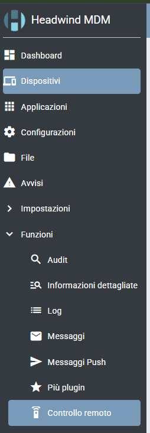
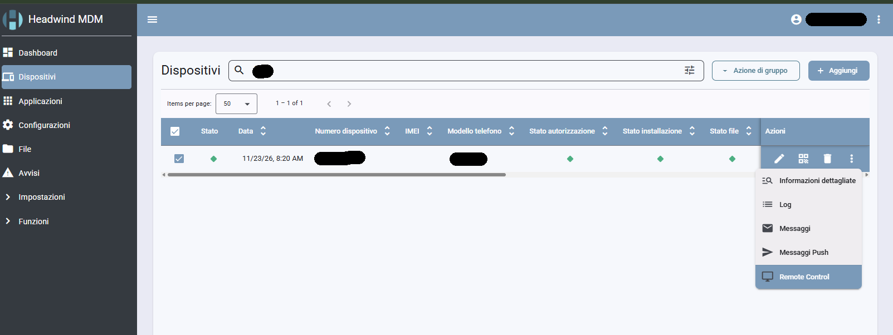
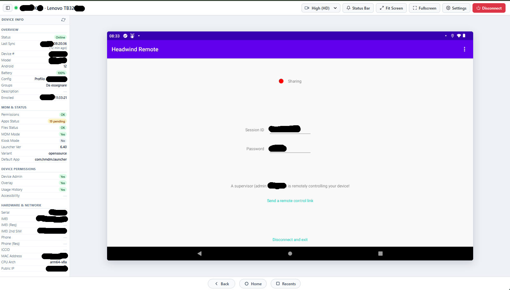
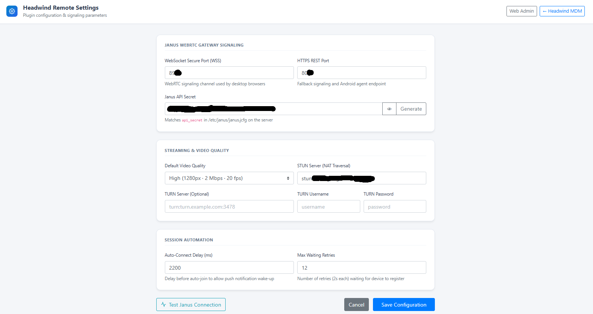

# Headwind Remote Control Plugin for Headwind MDM

[](https://github.com)
[](https://h-mdm.com)
[](https://janus.conf.meetecho.com)
[](https://developer.android.com)
[](LICENSE)

A high-performance, open-source **Remote Screen Sharing and Interactive Control Plugin** designed natively for **Headwind MDM**.

Enables administrators and technical support teams to remotely view and control managed Android smartphones, tablets, and rugged handhelds directly inside their web browser with **1 click**, sub-second latency, and zero supervisor software installation.

---

## 📑 Table of Contents

- [Visual Showcase](#-visual-showcase)
- [Key Features](#-key-features)
- [System Architecture](#-system-architecture)
- [Prerequisites](#-prerequisites)
- [Quick Installation](#-quick-installation)
- [Updating / Upgrades](#-updating--upgrades)
- [Web Administration & Settings](#-web-administration--settings)
- [Android Agent Setup](#-android-agent-setup)
- [Building from Source](#-building-from-source)
- [Project Structure](#-project-structure)
- [Troubleshooting](#-troubleshooting)
- [Security & Privacy](#-security--privacy)
- [License](#-license)

---

## 📸 Visual Showcase

<div align="center">

### 1. Seamless Native Integration in Headwind MDM
Directly integrated into both the **Main Navigation Sidebar** (under *Functions*) and the **Devices** table action popup (`⋮`):
<br><br>

<table align="center">
  <tr valign="top">
    <td align="center" width="32%">
      <b>Main Sidebar Navigation</b><br><br>
      
    </td>
    <td align="center" width="68%">
      <b>Devices Table 1-Click Action Menu</b><br><br>
      
    </td>
  </tr>
</table>

<br><br>

### 2. High-Performance WebRTC Remote Control Viewer
Live screen streaming, remote navigation buttons (Back, Home, Recents), video quality selector, and real-time device hardware & MDM policy inspector:
<br><br>


<br><br>

### 3. Comprehensive Web GUI Settings Manager
Dynamic signaling ports, cryptographically secure secret generation, video quality presets, and 1-click gateway diagnostics:
<br><br>


</div>

---

## ✨ Key Features

- **🚀 1-Click Remote Control:** Seamlessly integrated into the Headwind MDM **Devices** table (via the 3-dots menu `⋮`) and device details view.
- **⚡ Ultra Low-Latency WebRTC:** Powered by the Janus WebRTC Gateway for real-time video streaming (sub-500ms latency) and bi-directional signaling.
- **📱 Universal Dynamic Android APK:** Android agent (`com.hmdm.control`) receives the server URL, session ID, and temporary credentials automatically on every session via native Headwind MDM push notifications.
- **⚙️ Web GUI Settings Manager:** Configure Janus signaling ports, generate random API secrets, adjust default streaming quality, and test gateway reachability directly from the browser.
- **🔄 Headwind MDM Update Resilience:** Built-in systemd watchdog (`headwind-remote-sync.path`) ensures that when Headwind MDM is upgraded or reinstalled, all UI hooks and menus are automatically restored within seconds.
- **🔒 Integrated Single Sign-On (SSO):** Enforces Headwind MDM session validation (`HmdmAuthFilter`) on all plugin endpoints. Unauthorized requests are redirected or blocked with HTTP 403.
- **🎛️ Live Video Quality Switching:** Dynamically switch resolution and bitrate mid-session (`High HD 1280px`, `Medium SD 800px`, `Low 800px`, `Ultra FHD 1920px`) with automatic device synchronization.
- **🖥️ 1:1 Pixel & Fit Screen Modes:** Toggle between native 1:1 device resolution with smooth scrolling and responsive fit-to-screen mode.
- **📊 Real-time Device Details Sidebar:** Live inspector showing device hardware specs, battery percentage, network IP/MAC, MDM policy permissions, and app status.
- **⌨️ Remote Gestures & Navigation:** Virtual Android navigation bar (`Back`, `Home`, `Recents`), notification shade pull-down, and keyboard text injection.

---

## 🏛 System Architecture

```text
  +-----------------------------------------------------------------------+
  |                        Desktop Web Browser                            |
  |  - Headwind MDM Console (Devices Table / Details)                     |
  |  - Remote Control Viewer (HTML5 Canvas / WebRTC Video / Touch Events) |
  +--------------------+------------------------------+-------------------+
                       | HTTPS / WSS                  | HTTPS (REST / SSO)
                       v                              v
       +-------------------------------+    +-----------------------------+
       |   Janus WebRTC Gateway        |    | Headwind MDM Server         |
       |   - Streaming Plugin (Video)  |    | - Tomcat 9 / 10 (Port 8443) |
       |   - TextRoom Plugin (Gestures)|    | - web-admin.war (SSO Filter)|
       |   - WSS: 8989 / HTTPS: 8089   |    | - Push Notification Service |
       +---------------+---------------+    +--------------+--------------+
                       ^                                   |
                       | WebRTC RTP / DataChannel          | MDM Push
                       v                                   v
  +--------------------+-----------------------------------+--------------+
  |                        Managed Android Device                         |
  |  - Headwind Remote Agent (com.hmdm.control v2.4-custom)               |
  |  - MediaProjection Screen Capture + WebRTC H.264 Hardware Encoder     |
  |  - Accessibility Service (Touch & Gesture Injection)                  |
  +-----------------------------------------------------------------------+
```

---

## 📋 Prerequisites

- **Server Operating System:** Ubuntu (20.04, 22.04, 24.04 LTS) or Debian (11, 12).
- **Headwind MDM:** Community or Enterprise version 7.0+ running on Apache Tomcat 10 or 9 (installed at `/var/lib/tomcat10` or `/var/lib/tomcat9`).
- **Domain & SSL:** A valid Fully Qualified Domain Name (FQDN) with active SSL certificates (e.g. Let's Encrypt certificates at `/etc/letsencrypt/live/<domain>/`).
- **Network & Firewall Ports:**
  - `8089/tcp` - Janus HTTPS REST signaling and Android agent endpoint.
  - `8989/tcp` - Janus Secure WebSocket (WSS) signaling channel used by desktop browsers.
  - `20000-40000/udp` - WebRTC RTP/RTCP media streams.

---

## 🚀 Quick Installation

Run the automated installer on your Headwind MDM server:

```bash
# 1. Clone the repository
git clone https://github.com/<your-username>/headwind_remote_control.git
cd headwind_remote_control

# 2. Grant executable permissions
chmod +x install.sh update.sh uninstall.sh

# 3. Run the automated installer as root
sudo ./install.sh
```

### What `install.sh` handles automatically:
1. Detects your Tomcat installation, service name, domain name, and SSL certificates.
2. Installs required system packages: `janus`, `libmicrohttpd-dev`, `libjansson-dev`, `curl`, `jq`, `openssl`.
3. Configures Janus WebRTC Gateway with SSL encryption on ports `8089` (HTTPS) and `8989` (WSS).
4. Generates a secure Janus API secret (or preserves existing credentials if updating).
5. Creates `/etc/tomcat10/Catalina/headwind-remote.json` and grants required Tomcat sandboxing permissions.
6. Deploys the pre-built `web-admin.war` into Tomcat.
7. Injects the `remote-hook.js` script into `webapps/ROOT/index.html` and synchronizes Angular Service Worker hashes.
8. Configures and starts the systemd update-persistence watchdog (`headwind-remote-sync.path`).
9. Configures UFW firewall rules automatically.

---

## 🔄 Updating / Upgrades

### Updating Headwind Remote Control
When pulling a newer version from GitHub, simply run:

```bash
cd headwind_remote_control
git pull origin main
sudo ./update.sh
```

`update.sh` will:
- Safely update `web-admin.war` in Tomcat without disturbing existing configurations or credentials.
- Update `/usr/local/bin/headwind-remote-sync`.
- Re-sync UI hooks and verify that all services (`janus`, `tomcat`) are healthy.

### Upgrading Headwind MDM
When you update or reinstall the main Headwind MDM server software, the system often replaces `webapps/ROOT/index.html`.
The built-in **`headwind-remote-sync` watchdog** monitors the file and **automatically re-injects the remote control hook within seconds**. No manual intervention is needed.

---

## ⚙️ Web Administration & Settings

All plugin settings can be managed directly from the web browser:

<p align="center">
  
</p>

1. Open your browser and navigate to `https://<your-domain>/web-admin/` (or launch a remote session from the MDM panel).
2. Click the **⚙️ Settings** button on the top-right navigation bar.
3. Configuration options available:
   - **WebSocket Secure Port (WSS):** Default `8989`.
   - **HTTPS REST Port:** Default `8089`.
   - **Janus API Secret:** Click **Generate** to create a cryptographically secure 32-character key, or enter your custom secret.
   - **Streaming & Video Quality:** Choose default quality:
     - `High (HD)`: 1280px / 2.0 Mbps / 20 fps *(Recommended)*
     - `Medium (SD)`: 800px / 1.0 Mbps / 15 fps
     - `Low`: 800px / 512 Kbps / 12 fps
     - `Ultra (FHD)`: 1920px / 4.0 Mbps / 30 fps
   - **STUN / TURN Server:** Configure custom TURN credentials for strict corporate networks and firewalls.
4. Click **Test Janus Connection** to verify gateway reachability.
5. Click **Save Configuration** — changes take effect immediately without restarting Tomcat or Janus.

---

## 📱 Android Agent Setup

The repository includes the pre-compiled, signed Android agent APK: `headwind-remote-custom.apk`.

1. Log in to your **Headwind MDM Web Console** as administrator.
2. Navigate to **Applications** -> click **+ Add**.
3. Fill in the application metadata:
   - **Application Name:** `Headwind Remote`
   - **Package ID:** `com.hmdm.control`
   - **Version:** `2.4-custom`
   - **File:** Upload `headwind-remote-custom.apk` from the root of this repository.
4. Open the **Configurations** tab and ensure `com.hmdm.control` is added and enabled in your device configuration.
5. When the app is installed on the managed device, grant the required **Accessibility Service** permission when prompted (enables remote gesture injection).
6. In the MDM **Devices** table, click the **3-dots menu (⋮)** on any device and select **Remote Control**!

<p align="center">
  
</p>

Once connected, the live control console opens with real-time video, device telemetry, and navigation controls:

<p align="center">
  
</p>

---

## 🛠️ Building from Source

### 1. Build Signed Android APK
The Android client uses Gradle and the official WebRTC Android SDK.

To build the APK:
```bash
# Build generic public release APK (clean, no embedded host/secret)
python scripts/build_android_apk.py --generic

# Or build custom APK using credentials from secrets.key
python scripts/build_android_apk.py
```
Output: `headwind-remote-custom.apk` (signed with PKCS12 release key, verified by `apksigner`).

### 2. Build & Deploy Web-Admin WAR
To compile Java Servlets, bundle CSS/JS, and deploy `web-admin.war`:
```bash
# Build only (generates web-admin.war locally)
python scripts/deploy_webadmin.py --build-only

# Build and deploy directly to remote server via SFTP
python scripts/deploy_webadmin.py
```

---

## 📂 Project Structure

```text
headwind_remote_control/
├── client-android/               # Complete Android agent source code (Gradle project)
│   ├── app/                      # Main application module (WebRTC, screen capture, accessibility)
│   └── build.gradle              # App build configuration (version 2.4-custom)
├── server/
│   └── web-admin/                # Web Administrator & viewer application
│       ├── WEB-INF/              # web.xml servlet & filter definitions
│       ├── src/                  # Java source files (HmdmAuthFilter.java, ConfigServlet.java)
│       ├── css/                  # Frontend styles and themes
│       ├── js/                   # Janus client, gestures, clipboard, video, settings manager
│       ├── index.html            # Main remote control viewing window
│       ├── settings.html         # Dedicated settings management view
│       └── remote-hook.js        # Dynamic UI injection script for Headwind MDM panel
├── scripts/
│   ├── build_android_apk.py      # Automated Android compilation and APK signing script
│   └── deploy_webadmin.py        # Automated Java compiler, WAR bundler, and deployment script
├── images/                       # Screenshots and visual documentation assets
├── headwind-remote-custom.apk    # Pre-compiled, signed production Android agent (v2.4-custom)
├── web-admin.war                 # Pre-compiled production web application archive (WAR)
├── install.sh                    # Full automated installer for Ubuntu/Debian Headwind MDM servers
├── update.sh                     # Automated update and maintenance script
├── uninstall.sh                  # Clean uninstaller script
├── publish_github.bat            # Maintainer script to initialize and push to GitHub
├── secrets.key.example           # Configuration template for local development/deployment
├── .gitignore                    # Comprehensive protection against committing credentials/keys
├── LICENSE                       # Apache License 2.0
└── README.md                     # Project documentation
```

---

## 🔧 Troubleshooting

### 1. "Remote Control" button is missing in Headwind MDM
Run the update script to re-inject the hook and flush browser cache:
```bash
sudo ./update.sh
```
Hard-refresh your browser (`Ctrl + Shift + R` or `Cmd + Shift + R`).

### 2. Video stream does not start / Connection timeout
- Check Janus service status:
  ```bash
  systemctl status janus
  ```
- Inspect Janus logs for errors:
  ```bash
  journalctl -u janus -n 50 --no-pager
  ```
- Ensure firewall ports are open:
  ```bash
  sudo ufw status
  ```
  Ports `8089/tcp`, `8989/tcp`, and UDP range `20000-40000/udp` must be allowed.

### 3. Screen sharing works, but clicks/gestures are not received
The Android agent requires Accessibility Service permissions to inject touch events.
- On the device, open **Settings** -> **Accessibility** -> **Headwind Remote** -> enable the service.

### 4. Check Tomcat and Plugin REST Logs
```bash
journalctl -u tomcat10 -n 100 --no-pager
```

---

## 🔒 Security & Privacy

- **Single Sign-On (SSO):** All administrative pages, API endpoints, and configuration files are gated by `HmdmAuthFilter`. Only users logged in to Headwind MDM with device management or push permissions can access the remote console.
- **Zero Hardcoded Secrets:** Configuration keys and secrets are generated dynamically on installation and exchanged securely over encrypted HTTPS/WSS channels.
- **Media Encryption:** All screen sharing video and control data packets are encrypted using DTLS-SRTP as mandated by the WebRTC standard.
- **Session Isolation:** Remote control sessions use isolated room IDs and dynamic PIN authentication.

---

## 📄 License

This project is licensed under the **Apache License, Version 2.0**.
See the [LICENSE](LICENSE) file for details.
